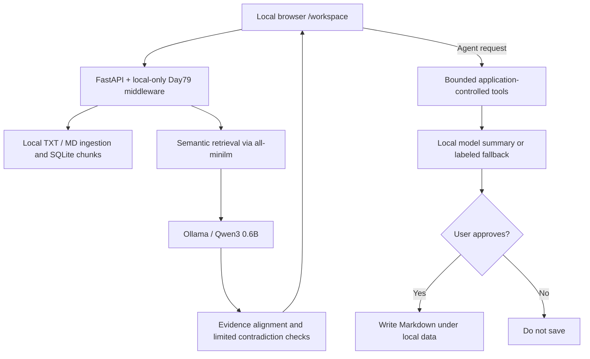

# KnowledgeAI — Flagship Beta Integration (Day 80)

## Product story and scope

**Problem:** Students and knowledge workers need to ask questions about their own notes while seeing where an answer came from. Generic chat may give unsupported claims. **Primary beta:** A *document-first*, local source-aware assistant. Other capabilities are integrated as supporting tools, not separate branded demo projects.

**Users:** An individual working on their own computer with non-sensitive `.txt` or `.md` notes. **Not users:** Public multi-tenant customers, enterprise teams, or anyone needing protected health/financial/confidential records.

**Main page:** `http://127.0.0.1:8002/workspace` (after starting the local server). It has a working document-upload and Q&A flow connected to the established Day 76/77 RAG endpoints, and navigation to existing Chat, Conversations, Tools, Agent Studio, Evaluation, and Privacy Center. No fake subscriptions, account systems, public access or usage statistics are shown.

## Data and control flow

**Identity and permissions:** Workspace tokens provide *prototype separation*, not production authentication or authorization. The Day 79 middleware restricts local browser use and basic cross-origin writes but does not establish secure public accounts. Deployment must remain local until authentication, authorization, TLS, reviewable retention/deletion controls and independent security tests are added.

## Quality and evaluation

- `scripts/day77_evaluate_25.py` is a repeatable **real-model** evaluation against three fictional documents.
- Latest previously observed run: **22/25 (88%)**, from **2026-11-22**. Categories: direct 12/12, paraphrase 4/5, misleading 1/3, missing 5/5.
- Remaining false abstentions: #15 Saturday library hours, #18 free/paid workshop correction, #19 20 MB versus 12 MB upload limit.
- This 25-item set is limited, repeated fixes were tested against it, and it is **not a production accuracy score**. Citation string matching is not complete semantic entailment. The small model can generate wrong or contradictory claims.
- Previous Day 79: **324 automated tests** and smoke checks passed before Day 80. Day 80 adds beta integration tests, local smoke checks and visual acceptance.

## Performance and cost

The Day 79 benchmark measured lightweight **local HTTP endpoints without Ollama inference**; do not mistake those measurements for real user answer latency. A live beta demo should record wall-clock duration for answer generation separately. Local Ollama avoids paid hosted API calls, but requires hardware, memory, electrical power, disk and future hosting/security resources. No universal monthly operating cost is claimed.

## Day 80 acceptance walkthrough

1. Start Uvicorn bound to `127.0.0.1:8002`, ensure Ollama local model is available, and open `/workspace`.
2. Index a **fictional, non-sensitive** `.txt` note from the workspace (or reuse a note already indexed in the same browser workspace).
3. Ask a factual question, check the answer and exact supporting quote. Try a missing fact; the assistant should not fabricate evidence.
4. Open `/conversations`, `/tools`, and `/agent` from the same navigation. Draft a sample brief; approval must occur before a local report can be saved. Test a rejection too.
5. Open `/evaluation` and `/privacy`; confirm the limitations are visible. Use a narrow/mobile browser viewport to inspect layout.
6. Run the full regression suite and `python -m scripts.day80_beta_smoke`. Confirm no unexpected files changed before committing.
7. Capture a roughly three-minute **local demo** covering upload, grounded answer, approval and limitations. Public deployment remains explicitly deferred until production authentication and security are implemented.

## Limitations and next investment

- No production login, permissions or full administrator account console. `/evaluation` is a local transparency/quality view, **not** a production admin dashboard.
- Document ingestion currently supports TXT/MD, not PDF ingestion in the RAG index.
- Quotes are verbatim source fragments, not complete proof of correctness; the Day 77 false-abstention cases remain known.
- Agents perform bounded local-only actions and need human approval before saving a report.
- Database data may persist after browser storage is cleared. Encryption at rest is not guaranteed.
- No public hosted beta, multi-user isolation or enterprise-grade monitoring. Before public access: proper authorization, TLS, deletion/export controls, stronger evals, upload/body streaming limits, injection review and security testing.

## Day 80 value

One coherent flagship **local beta** and demonstrable engineering case study; public launch is a future milestone that must meet additional gates. The goal is useful, trustworthy behavior, not a perfect synthetic score.
